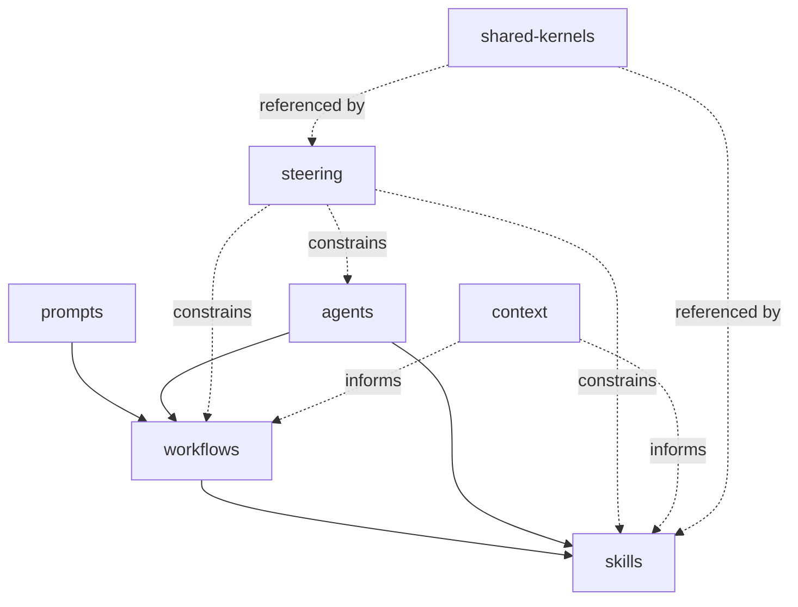
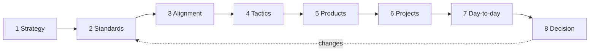

# Layout and the eight levels

**Diataxis:** Explanation

## Four questions for every artifact

Each artifact's frontmatter answers four questions, so folders describe location and fields describe meaning:

- **Who wrote it?** `origin`: `authored` here, or `referenced` from an external source with a `source` field.
- **Who reads it?** `audience`: `human`, `agent`, or `both`.
- **Where does it sit?** `level`: the altitude in the cascade below, from 1 to 8.
- **Is it usable?** `status`: `draft`, `active`, or `deprecated`.

## How the layers depend on each other

Arrows point from the caller to what it uses. Steering constrains and never depends on a skill.

## The eight levels

The levels run from intent to execution. Each lower level declares which higher level it implements.

| Level | Question | Artifact type | Folder |
|---|---|---|---|
| 1 Strategy | Where are we going? | Intent, revised often | `context/` |
| 2 Standards | What rules bind the work? | Normative | `steering/` |
| 3 Alignment | What do the words mean? | Agreed terms | `context/` (glossary) |
| 4 Tactics | How is the work run? | Process | `workflows/`, `skills/` |
| 5 Products | What does it produce? | Templates | consumer repositories |
| 6 Projects | What work packages result? | Plans | consumer repositories |
| 7 Day-to-day | What is happening now? | Run records | consumer repositories |
| 8 Decision | What was decided, and by whom? | Decision records | `docs/` (ADRs, planned) |

Levels 5 to 7 are produced by running workflows and belong in the consumer repository that runs them. The harness defines only the templates and the rules.

## Context and shared kernels

- **Context** holds facts that change as the world changes.
- **Shared kernels** hold named models that are reused. Each is defined once and cited everywhere else.
- **Steering** holds rules. A rule change is a decision at level 8, recorded in `docs/`.
